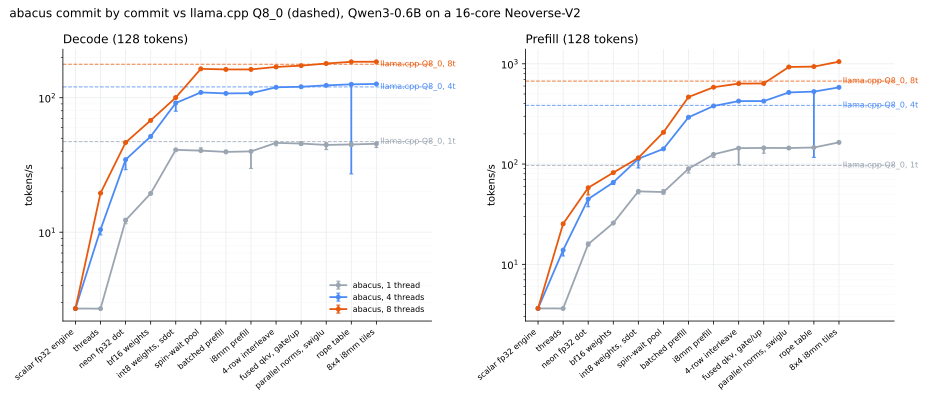

# abacus

abacus is a CPU inference engine for Qwen3 in about 1,400 lines of C, built up one commit at a time from a float32 loop to int8 kernels for arm64 and x86, with every commit checked against Hugging Face transformers and timed against llama.cpp on the same machine. It handles Qwen3-0.6B, 1.7B and 4B and runs on Linux (arm64 and x86-64) and on Apple Silicon Macs, and [the walkthrough](https://mottopanikeiku.github.io/abacus/) goes through its 20 engine commits with the lines each one changed and what that did to tokens per second.



## Run it

```sh
git clone https://github.com/mottopanikeiku/abacus && cd abacus
make
make model                                   # downloads Qwen3-0.6B (1.5 GB) and converts it, needs python3
./abacus model.bin -p "Why is the sky blue?"
```

`-t N` sets the number of threads (every core by default), `--temp 0` makes the output greedy, `--raw` skips the chat template, and `--q4` stores the layer weights in 4 bits instead of 8, which nearly halves the bytes each token reads and costs the accuracy shown under Models.

## Speed

The first 13 commits were timed on a 16-core AWS Graviton4 (Neoverse-V2) with Qwen3-0.6B, a 128-token prompt and 128 generated tokens, with both engines pinned to the first N cores. Taking the median of 5 interleaved runs, commit 13 compares like this with llama.cpp's Q8_0, which reads the same int8 format:

| Threads | abacus decode | llama.cpp Q8_0 | ratio | abacus prefill | llama.cpp Q8_0 | ratio |
|---:|---:|---:|---:|---:|---:|---:|
| 1 | 45 | 47 | 0.96x | 165 | 97 | 1.70x |
| 4 | 127 | 120 | 1.05x | 582 | 385 | 1.51x |
| 8 | 185 | 177 | 1.04x | 1051 | 672 | 1.56x |

The later commits were timed on GitHub's hosted runners by the benchmark workflow, with at least two jobs on each kind of runner. Because each job gets whatever host it lands on, absolute speed moved between jobs (by up to 27% on x86 and 2x on macOS) while the ratio between the engines within a repetition held, so the table gives that ratio for the last commit at each runner's full thread count, where all jobs agreed within their 95% intervals. The x86 jobs also land on different CPUs, so their results are grouped by CPU model and the kernels it got, and only the combinations that came up in more than one job are listed.

| Runner | CPU, kernels | Threads | Decode vs Q8_0 | Prefill vs Q8_0 | `--q4` decode vs Q4_0 | `--q4` prefill vs Q4_0 |
|---|---|---:|---:|---:|---:|---:|
| ubuntu-24.04-arm | Neoverse-N2, SMMLA | 4 | 1.16x | 1.25x | 1.40x | 1.03x |
| ubuntu-latest | AMD EPYC 9V74, AVX-512 VNNI | 4 | 0.99x | 1.10x | 0.93x | 0.82x |
| ubuntu-latest | AMD EPYC 7763, AVX2 | 4 | 0.93x | 1.07x | 0.97x | 0.95x |
| macos-14 | Apple M1, SDOT | 3 | 0.99x | 0.64x | 0.81x | 0.59x |

abacus is ahead of llama.cpp on the Neoverse-N2 runner in both decode and prefill, and its 4-bit decode there is 1.4 times as fast as llama.cpp's Q4_0. On the x86 runners it prefills a little faster than Q8_0 and decodes faster on one thread (1.37x on the EPYC 9V74), but at 4 threads its decode only ties or trails, and at that thread count llama.cpp's Q4_0 beats `--q4` in both decode and prefill. The M1 is where abacus trails most, with prefill at 0.64x of llama.cpp's even after the 4-token SDOT kernel of commit 20. Every runner has a folder under [results/runners/](results/runners) whose `table.md` has the tokens/s of every commit at every thread count, with intervals and each job on its own, and the Graviton4 run is in [results/table.md](results/table.md).

## Models

Any dense Qwen3 converts with `make model MODEL=Qwen3-1.7B` (or `Qwen3-4B`), which downloads it and writes `Qwen3-1.7B.bin`, and `make check MODEL=Qwen3-1.7B` compares abacus with transformers in float32. The check feeds four prompts and the reference's own greedy continuations through abacus and compares 128 next-token distributions, and it passes in int8 when abacus picks the reference's top token at 90% of positions or more and the mean KL divergence stays under 0.02, while `--q4` has to reach 80% and 0.25.

| Model | int8: same top token | int8: mean KL | `--q4`: same top token | `--q4`: mean KL |
|---|---:|---:|---:|---:|
| Qwen3-0.6B | 98% | 0.002 | 84% | 0.21 |
| Qwen3-1.7B | 97% | 0.005 | 81% | 0.54, fails |
| Qwen3-4B | 100% | 0.001 | 89% | 0.18 |

These are the decode path's numbers on the Graviton4, and [results/models/](results/models) has the prefill path and every prompt as well. Qwen3-1.7B has passed in int8 only since the Hadamard rotation in commit 19, before which it agreed on 94.5% of tokens with a mean KL of 0.026, and in 4 bits it still misses its limit.

## Platforms

On arm64 the kernels use SDOT (the dotprod extension) for single tokens and SMMLA (i8mm) for prompts four tokens at a time, with a 4-token SDOT kernel for CPUs that lack i8mm, such as Apple's M1 and AWS's Graviton2. On x86-64 the same kernels exist for AVX2, AVX-VNNI and AVX-512 VNNI. In both cases the engine asks the CPU at startup which extensions it has, so a binary built with `make ARCH=` (without `-march=native`) still picks the fastest kernels the machine can run, and a CPU with none of them gets a plain C kernel. CI builds and checks abacus on ubuntu-24.04-arm, ubuntu-latest and macos-14, and it runs the portable x86 build under Intel's emulator as Sandy Bridge, Haswell, Alder Lake and Ice Lake so that each x86 kernel gets picked and checked. Building needs a C compiler with `_Float16`, which on x86 means GCC 12 or newer or a recent clang.

## The ladder

Each line is one engine commit and the number its message carries. Lines 1 to 13 are median decode tokens/s at 8 threads on the Graviton4, or prefill tokens/s where the line says so, while the later lines name the runner behind their number and are at 4 threads unless they say otherwise.

1. [scalar fp32 engine: 2.7 tok/s](https://github.com/mottopanikeiku/abacus/commit/4b4c4f19ad62a130c8a08e3ed4b4af0e6da03fa6)
2. [threads: 2.7 -> 20 tok/s](https://github.com/mottopanikeiku/abacus/commit/d134f2310e20e630c40534b048a88fe2d086fc8c)
3. [neon fp32 dot: 20 -> 46 tok/s](https://github.com/mottopanikeiku/abacus/commit/55d0323cfacadc7d65d9cd3ce3d0e361a515e908)
4. [bf16 weights: 46 -> 68 tok/s](https://github.com/mottopanikeiku/abacus/commit/e078d48f2b74a7537bf22bdb10a114c2f36e4a1c)
5. [int8 weights, sdot: 68 -> 100 tok/s](https://github.com/mottopanikeiku/abacus/commit/8ec0e7bdd6d706a652a9cf45b98be4496fc83be2)
6. [spin-wait pool: 115 -> 208 prefill tok/s](https://github.com/mottopanikeiku/abacus/commit/b29302de63ef2e0ee8cd2fa6cb6eaa4483ec5d60)
7. [batched prefill: 208 -> 466 prefill tok/s](https://github.com/mottopanikeiku/abacus/commit/266bd929440a34712b006b1c3109d297bedb4cb2)
8. [i8mm prefill: 466 -> 584 prefill tok/s](https://github.com/mottopanikeiku/abacus/commit/f2555673404a7174b251d056f3d67d893d0fec67)
9. [4-row interleave: 584 -> 635 prefill tok/s](https://github.com/mottopanikeiku/abacus/commit/f3e7e391d0b984ce79ca0350f93ed4aa0c8a7d84)
10. [fused qkv, gate/up: 169 -> 173 tok/s](https://github.com/mottopanikeiku/abacus/commit/7f10e34cf039c1c90e776103007252b1bd045b61)
11. [parallel norms, swiglu: 636 -> 930 prefill tok/s](https://github.com/mottopanikeiku/abacus/commit/2e48ed27e936ded2941e1066ca68983151cec3bd)
12. [rope table: 180 -> 185 tok/s](https://github.com/mottopanikeiku/abacus/commit/e95a153f9eb5a1b92bfad1b4190f72ddc40c9a10)
13. [8x4 i8mm tiles: 938 -> 1051 prefill tok/s](https://github.com/mottopanikeiku/abacus/commit/d44797cbaf6dbfcc6d53ead731bdeb38b142d197)
14. [avx2 kernels: 3.0 -> 51 tok/s (epyc 9v74)](https://github.com/mottopanikeiku/abacus/commit/62a587b8e006f174f4c8cafa7833329ce1f15b76)
15. [vnni kernels: 208 -> 259 prefill tok/s (epyc 9v74)](https://github.com/mottopanikeiku/abacus/commit/9bf8f0374f3999ac0214d39dee8a8f9c0c2e21a9)
16. [runtime i8mm, macos: kernels chosen at startup, builds on macos](https://github.com/mottopanikeiku/abacus/commit/7ee9d008de42f9fef7c550a7c853f5559a552ddb)
17. [4-bit weights: --q4 decode 52 -> 76 tok/s (epyc 9v74)](https://github.com/mottopanikeiku/abacus/commit/2ddcd2e75bbc09cc2676156f0defef359ef9e3b0)
18. [parallel load: 1.7 -> 0.56 s load (neoverse-n2)](https://github.com/mottopanikeiku/abacus/commit/c273fbe35447f1bea3fe3b9c48855df044121c75)
19. [hadamard rotation: 1.7B KL 0.026 -> 0.005](https://github.com/mottopanikeiku/abacus/commit/380ecb9b6bad52f6328d8429372dd5f6a916a409)
20. [sdot prefill tiles: 109 -> 135 prefill tok/s (m1, 1 thread)](https://github.com/mottopanikeiku/abacus/commit/c7c47aaf12592de5adaa0e60564fc52564f767c0)

## How it works

| File | Lines | What |
|---|---:|---|
| [src/model.c](src/model.c) | 327 | load the model, run the transformer on a batch of tokens |
| [src/matmul.c](src/matmul.c) | 211 | quantization, the Hadamard rotation, splitting products over threads, the C kernel |
| [src/neon.c](src/neon.c) | 178 | SDOT and SMMLA kernels for arm64 |
| [src/x86.c](src/x86.c) | 135 | AVX2, AVX-VNNI and AVX-512 VNNI kernels |
| [src/main.c](src/main.c) | 189 | chat, benchmark and check modes |
| [src/tokenizer.c](src/tokenizer.c) | 183 | byte-level BPE with Qwen's pre-tokenizer rules |
| [src/abacus.h](src/abacus.h) | 108 | shared types |
| [src/pool.c](src/pool.c) | 64 | a spinning thread pool |

Weights are quantized to int8 at load in blocks of 32, each of which goes through a 32x32 Hadamard rotation first, and they are interleaved in groups of four rows, so that one token streams a single array and SMMLA finds its row pairs side by side. A prompt runs as one batch of up to 128 tokens, so each weight is read once per batch and used for every token in it, which is why prefill is where the kernels make the biggest difference. The block format and the 4-row interleave follow llama.cpp's Q8_0 and its repacked layouts, and rotating before quantizing is the idea behind QuaRot and QuIP#.

## Reproduce

```sh
uv run tools/reference.py models/Qwen3-0.6B ref    # transformers reference, once
uv run bench/run.py --threads 1,4,8 --reps 5     # check and time every commit and llama.cpp
```

`bench/run.py` builds each engine commit in its own git worktree, checks it, builds llama.cpp at a pinned commit (`LLAMA_COMMIT`) with its Q8_0 and Q4_0 conversions, and then times everything in a fresh random order in each repetition, after which `bench/report.py` redraws the chart and the table from `raw.jsonl`. The benchmark workflow runs this same script on whichever GitHub runner you pick, starting at the commit you give it.

abacus is MIT-licensed, and the model weights are Qwen's, under Apache-2.0.
