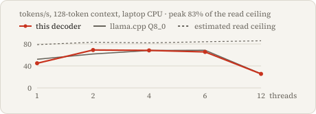

# What differs from llama.cpp

This page separates three comparisons with pinned llama.cpp Q8_0. Only the first produced the v2 timing result in the README.

| Comparison | Status | Where it is defined |
|---|---|---|
| [Executed cloud comparison](#executed-cloud-comparison) | Completed on 2026-10-07: six cells, one cloud host | [design](../tools/cloud_vnni_design.json), [driver](../tools/cloud_bench.cpp), [runner](../tools/cloud_run.py), [results](../results/v2/cloud-vnni/final/summary.json) |
| [Laptop protocol](#laptop-protocol-not-run) | Implemented, never run as a complete matrix | [`measure_v2`](../tools/measure_v2.py), [`run_final_v2`](../tools/run_final_v2.py), [`make final`](../Makefile) |
| [Archived v1 laptop comparison](#archived-v1-laptop-comparison) | Completed before v2; unchanged | [tables](../results/tables.md), [raw samples](../results/measurements) |

All three use pinned Qwen2.5-0.5B-Instruct revision `7ae557604adf67be50417f59c2c2f167def9a775` and llama.cpp commit `6c73b3e12dc501de35fe5f6979960d06921a2f6c`. Each Q8_0 GGUF is converted from the same verified BF16 snapshot as the native weights; no third-party prequantized model is used.

## Quality gates

Two different numerical gates exist, and they apply to different native kernels. Both compare against the real Q8_0 path on the same corpus positions; neither measures task accuracy.

- **Weight format, FP32 activations.** [`format-selection.json`](../results/v2/format-selection.json) chooses g64f16 among four calibration formats: the fewest artifact bytes with calibration mean KL and p99 KL strictly below Q8_0 and top-1 agreement strictly above. Perplexity is report-only.
- **Int8 activations (`vnni`): four metrics.** Heldout mean KL ≤ Q8_0, p99 KL ≤ Q8_0, top-1 agreement ≥ Q8_0 **and** perplexity ≤ Q8_0. The [current decision](../results/v2/quality-vnni16-final.json) rejects g64f16 with int8 activations, as the [earlier report](../results/v2/quality.json) rejected g32f16. The int8-activation path is therefore not part of any final timing.
- **Signed-int16 activations (`vnni16`): three metrics.** With the g64f16 weights fixed, calibration and shipped-F16-KV heldout mean KL and p99 KL must be strictly below Q8_0 and top-1 agreement strictly above. Perplexity is report-only, and the F32-KV run is a linked control. The [recorded comparison](../results/v2/quality-vnni16-final.json) retains this path, although its heldout perplexity is slightly worse than Q8_0 (16.60984 versus 16.60406).

[MEASUREMENTS.md](MEASUREMENTS.md#signed-int16-activation-path) gives the int16 arithmetic and how the laptop runner rechecks these reports.

## Executed cloud comparison

This is the experiment behind the README's six-cell table. I committed its [design](../tools/cloud_vnni_design.json) before collecting results; its `native_repository` field still names the pre-rename `cpu-decode` URL, which I leave unchanged because the file is the frozen design. [MEASUREMENTS.md](MEASUREMENTS.md#vnni-only-cloud-comparison) records the host search, failed attempts, booking and cost.

**Host.** One accepted CPU-only container exposing 24 virtual CPUs of an AMD Zen 4 EPYC, identified from CPUID family 25/model 17; the model name was not exposed. Both engines were compiled fresh on that host with GCC 12.2.0 and `-march=native`. All six cells ran in one container.

**Native path.** The g64f16 weights fixed by hash in the design, the `vnni16` kernel with signed-int16 activations, F16 KV, blocked attention and the persistent strict worker pool. The runner refuses weights whose hash differs from the design and refuses a container without the instructions `vnni16` requires, so no FP32 fallback can enter the run. It does not reread the quality reports; eligibility comes from the int16 three-metric gate above, recorded for the same weights. The driver holds the public `CpuBinding` for the worker lifetime, avoiding per-operator affinity syscalls. This measures the kernels and scheduler under that binding, not unchanged laptop CLI behavior.

**Baseline path.** llama.cpp built Release with `GGML_NATIVE=ON`, `GGML_OPENMP=OFF`, CUDA and Vulkan off and `GGML_CPU_REPACK=ON`, run through its own persistent strict threadpool with poll 50. Repacking was enabled, but the retained logs show no repacked buffer in any cell. Before each cell's final samples, three pilot observations of flash attention on, off and auto selected the setting with the smallest pilot median; the effective setting was off at one thread and on at two and four threads. Pilot observations are retained and excluded from inference. This is one tuned baseline configuration per cell, not the nine-candidate search of the laptop protocol.

**Shared workload.** Threads 1, 2 and 4 on the same first N exposed CPUs for both engines; initial contexts 128 and 4096; F16 K/V in both. One driver, [`cloud_bench.cpp`](../tools/cloud_bench.cpp), calls both engines. Each worker loads once, prefills the same seed token IDs repeated to the context, and runs one untimed 128-step warmup. Each measured sample rewinds to that context and times 128 complete single-token forwards, including the LM head and the same earliest-tie greedy argmax on both paths and the forward of the final consumed token. Load, prefill, warmup, rewind and JSON output are outside the clock, and there are no operation timers. Each engine follows its own greedy trajectory, so shapes match but generated tokens need not.

**Sampling.** Both workers stay resident. The idle native worker is suspended with SIGSTOP, and the idle GGML pool is paused through its public API, both outside the clock. Each cell has eight ABBA quartets (native, llama, llama, native), giving sixteen chronological pairs. The estimate is the median paired ratio of llama seconds to native seconds, which equals native/llama throughput for equal steps. The interval is a 95% percentile bootstrap over whole quartets: 20,000 draws, seed 20261007. Intervals are per-cell, not simultaneous. A cell counts as a native win only if its interval lies entirely above 1; all six did.

**Not established.** Other hosts, clocks or NUMA layouts; a read-bandwidth ceiling on this host; the laptop CLI path; v3 batching, lookup or int8-KV speed; or a causal VNNI speedup. The [earlier AVX2 cloud attempt](../results/v2/cloud/summary.json) ran on a different host and completed two of six cells.

## Laptop protocol (not run)

[`tools/measure_v2.py`](../tools/measure_v2.py) and [`tools/run_final_v2.py`](../tools/run_final_v2.py) implement a stricter laptop comparison. I never ran its complete matrix, so the README contains no results from it. Some development windows used parts of this protocol with shorter sampling; they are labelled development data in [MEASUREMENTS.md](MEASUREMENTS.md#signed-int16-activation-path) and cannot be aggregated into a final result. Everything in this section describes what the tools would do.

**Matrix and native settings.** Threads 1, 2, 4, 6 and 12 × initial contexts 128, 1024 and 4096. `freeze` fixes the native kernel, weight artifact, group size, scale dtype, scheduler, attention and affinity before any final window. The weight artifact is whatever the calibration selection chose; in the committed selection that is g64f16, 8.25 bits per matrix weight versus Q8_0's 8.5. `make final` uses `vnni16` only if its three-metric gate passed, otherwise the configured FP32 kernel. `--kernel vnni` additionally requires the four-metric int8-activation decision.

**Baseline candidates.** The upstream build from [`prepare_llama.py`](../tools/prepare_llama.py) keeps upstream defaults for OpenMP, BLAS and repacking; the CMake caches recorded in the development protocols show `GGML_NATIVE=ON`, `GGML_BLAS=OFF`, `GGML_OPENMP=ON` and `GGML_CPU_REPACK=ON`. It is timed with `llama-bench`. Each cell tries flash attention on, off and auto across three affinity categories: nine candidates. Pinned and unpinned candidates run under `taskset` on N physical-first selected CPUs; pinned also applies the matching mask with strict 1, unpinned uses mask 0 and strict 0. `defaults` uses the full frozen allowed mask with mask 0 and strict 0. The reported competitor would be the candidate with the highest median, a conservative choice that favors the baseline. Actual CPU sets and `winner_core_sets_matched` are recorded rather than assumed.

Process-level affinity is needed even for pinned one-thread candidates: at this commit, upstream's [single-thread OpenMP branch](https://github.com/ggml-org/llama.cpp/blob/6c73b3e12dc501de35fe5f6979960d06921a2f6c/ggml/src/ggml-cpu/ggml-cpu.c#L3430-L3442) does not apply the [stored thread mask](https://github.com/ggml-org/llama.cpp/blob/6c73b3e12dc501de35fe5f6979960d06921a2f6c/ggml/src/ggml-cpu/ggml-cpu.c#L3350-L3356), so echoed mask/strict flags are not enough. Native affinity is frozen as `strict` (N selected CPUs) or `unpinned` (the full allowed mask without per-worker binding), and the read-bandwidth probe follows the same native policy.

**Sampling.** Only one model is resident at a time. Each candidate alternates **A B A B**: a native process with five repeats of 64 decoded tokens exits before a llama process with five repeats starts, then both repeat. Native prefills once per invocation and warms once at the requested context; `llama-bench` warms before its depth fill. The winner's ten samples are compared with the ten native samples interleaved with it, so one nine-candidate cell has 90 native samples.

**Remaining differences.** Initial context and decode length match; token IDs and trajectories do not. Native includes greedy argmax and per-operation instrumentation, while `llama-bench` uses synthetic tokens and excludes sampling and tokenization. Native's unique-head, actual-format byte profile supplies a read-bandwidth ceiling. No speed gap would be attributed solely to storage bandwidth, VNNI, attention or scheduling without the fixed-cell ablations and numerical checks.

## Upstream implementation facts

These source facts apply to every comparison above. In pinned source, [the Q8_0 trait](https://github.com/ggml-org/llama.cpp/blob/6c73b3e12dc501de35fe5f6979960d06921a2f6c/ggml/src/ggml-cpu/ggml-cpu.c#L272-L279) converts activations to Q8_0 and supplies its integer-dot path. The [x86 dot implementation](https://github.com/ggml-org/llama.cpp/blob/6c73b3e12dc501de35fe5f6979960d06921a2f6c/ggml/src/ggml-cpu/arch/x86/quants.c#L1308-L1374) loads 32 signed weights and activations into 256-bit vectors, combines their FP16 scales and uses an FMA accumulation when compiled with AVX2. Its [integer helper branches](https://github.com/ggml-org/llama.cpp/blob/6c73b3e12dc501de35fe5f6979960d06921a2f6c/ggml/src/ggml-cpu/arch/x86/quants.c#L105-L133) distinguish AVX-VNNI-INT8, AVX512-VNNI+VL, AVX-VNNI and multiply/add fallback. These are source-established alternatives. A [debugger hit](../results/v2/hot-kernel-q8.json) in the laptop's `llama-bench` build shows `ggml_vec_dot_q8_0_q8_0` executing VEX `vpdpbusd`; I have no equivalent trace from the cloud host. A CPU-feature banner alone does not trace operator dispatch, and disabled BLAS does not rule out the separately compiled llamafile SGEMM path.

Repacking needs the same care. Enabled repacking means extra CPU buffer types were allowed. [Q8_0's optimal-repack selector](https://github.com/ggml-org/llama.cpp/blob/6c73b3e12dc501de35fe5f6979960d06921a2f6c/ggml/src/ggml-cpu/repack.cpp#L5105-L5126) in this commit has NEON and RISC-V branches and no x86 Q8_0 branch. [Per-tensor debug messages](https://github.com/ggml-org/llama.cpp/blob/6c73b3e12dc501de35fe5f6979960d06921a2f6c/ggml/src/ggml-cpu/repack.cpp#L4916-L4919) and CPU_REPACK buffer messages in the saved logs show repacking when it happens. Enabled repacking is not "Q8_0 x86 repacking", and speed alone does not identify a VNNI or BLAS kernel.

Weight formats differ even at similar sizes. Native g64f16 stores int8 weights in 64-value groups with F16 scales; Q8_0 stores 32-value blocks with F16 scales. Their activation quantization also differs: Q8_0 quantizes activations to int8 blocks, native `vnni16` to signed int16 in 64-value groups, and native FP32 kernels not at all. Quality measurements, not bit width, determine their numerical differences.

## Archived v1 laptop comparison

This section describes the original laptop results, which remain unchanged. None of it describes the v2 cloud comparison or the laptop protocol above. The figure below was made before the rename; its embedded title still says cpu-decode.

<picture><source media="(prefers-color-scheme: dark)" srcset="hero-dark.svg"></picture>

At two threads and context 128, v1 measured **69.03 tokens/s**, **83.1% of an estimated read-bandwidth ceiling**. The ceiling divides measured read bandwidth by modeled bytes/token; the percentage is not measured DRAM utilization. Across all [15 cells](../results/tables.md), v1 medians led Q8_0 in 3 and trailed in every context-4096 cell.

The baseline is pinned in [`results/llama-preparation.json`](../results/llama-preparation.json): built from source with `GGML_NATIVE=ON`, OpenMP enabled, CPU only, Release mode and four build jobs, and timed with `llama-bench`.

The v1 int8 path widens signed weights to FP32 in each dot product, keeps FP32 activations and applies one FP32 scale per output row. llama.cpp's Q8_0 path quantizes the input vector to Q8_0 and computes integer dot products before applying block scales. This is a concrete algorithmic difference, not just a compiler switch: it can reduce arithmetic spent widening and multiplying each weight, at the cost of an additional activation quantization. The formats are comparable bit widths, not identical accuracy or storage layouts.

v1 opened separate static OpenMP row/head regions for individual operations. The baseline's compiled OpenMP path keeps one team across a complete graph evaluation ([source](https://github.com/ggml-org/llama.cpp/blob/6c73b3e12dc501de35fe5f6979960d06921a2f6c/ggml/src/ggml-cpu/ggml-cpu.c#L3419-L3438)). v1 attention was scalar FP32 inside each head; its SIMD setting changed only matrix-vector products. These differences are plausible explanations for a gap, not experimentally isolated causes.

For timing, v1 included greedy argmax and per-operation instrumentation; `llama-bench` excludes sampling and tokenization. Initial context lengths, generation length, thread counts, warmup step counts and repetitions were matched. v1 used FP32 K/V, while unchanged upstream llama.cpp used default F16 K/V and flash attention auto, favoring its cache traffic and attention kernels. Prompt IDs and generated trajectories were not matched: `llama-bench` uses synthetic inputs, whereas v1 repeated a fixed token sequence then decoded greedily. The eager Transformers reference uses BF16 weights and KV, so it is a separate naive comparison rather than a numerically matched int8 engine.

## Dependency attribution

The decoder core is written from scratch; it does not link ggml or reuse upstream inference kernels. The optional quality reader and the cloud driver link the pinned llama.cpp library to measure its real outputs and timings. [nlohmann/json 3.11.3](https://github.com/nlohmann/json/tree/v3.11.3), under the [MIT license](https://github.com/nlohmann/json/blob/v3.11.3/LICENSE.MIT), parses Safetensors headers and configuration JSON. CMake uses an available system package or its pinned release download. The repository's code is MIT licensed; Qwen weights remain under [Apache-2.0](https://huggingface.co/Qwen/Qwen2.5-0.5B-Instruct/blob/7ae557604adf67be50417f59c2c2f167def9a775/LICENSE). Baseline builds remain outside the repository.
